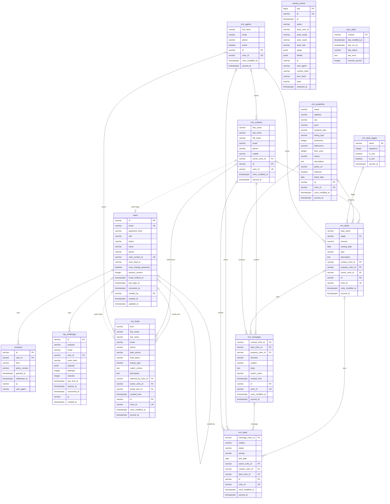

# Client Portal data model

> Generated by `python -m app.cli data-model` from `app/db.py`. Do not edit by hand.

Two groups of tables, all in the private `portal` schema:

- **Portal-owned**: Held only by the portal. (4 tables)
- **CRM copy**: Synced from Zoho CRM, which stays the source of truth. (9 tables)

Keys: every table has a primary key (`PK`). CRM-copy tables use a portal UUID `id` plus the Zoho record id `zoho_id` (unique, `UK`); references between them (`FK`) point at `zoho_id` and are checked at commit. Dotted lines in the diagram are links matched on Zoho ids but not enforced.

## Diagram

## Data dictionary

### Portal-owned

Held only by the portal.

#### `users`

Portal logins: admins, clients (linked to a Zoho Contact with an active deal) and guests (a Zoho Lead).

| Column | Type | Key | Null | Description / Zoho source |
|---|---|---|---|---|
| `id` | varchar | PK | no |  |
| `email` | varchar | UK | no | Sign-in email (lower case) |
| `password_hash` | varchar |  | no | scrypt hash; never the password |
| `role` | varchar |  | no | admin / client / guest |
| `status` | varchar |  | no | active / disabled / erased |
| `name` | varchar |  | yes |  |
| `phone` | varchar |  | yes |  |
| `zoho_contact_id` | varchar | UK | yes | Clients: their Zoho Contact (crm_contacts.zoho_id) |
| `zoho_lead_id` | varchar |  | yes | Guests: the Zoho Lead created at sign-up (crm_leads.zoho_id) |
| `must_change_password` | boolean |  | no |  |
| `session_version` | integer |  | no | Bumped to sign the user out everywhere |
| `email_verified_at` | timestamptz |  | yes |  |
| `last_login_at` | timestamptz |  | yes |  |
| `converted_at` | timestamptz |  | yes |  |
| `created_by` | varchar | FK → users.id | yes |  |
| `created_at` | timestamptz |  | no |  |
| `updated_at` | timestamptz |  | no |  |

Rules: `status IN ('active', 'disabled', 'erased')`; `role <> 'client' OR zoho_contact_id IS NOT NULL OR status = 'erased'`; `role IN ('admin', 'client', 'guest')`

#### `consents`

What each person agreed to, when, and under which privacy policy version.

| Column | Type | Key | Null | Description / Zoho source |
|---|---|---|---|---|
| `id` | varchar | PK | no |  |
| `user_id` | varchar | FK → users.id | no |  |
| `kind` | varchar |  | no | privacy_policy / contact_about_properties |
| `policy_version` | varchar |  | no |  |
| `granted_at` | timestamptz |  | no |  |
| `withdrawn_at` | timestamptz |  | yes |  |
| `ip` | varchar |  | yes |  |
| `user_agent` | varchar |  | yes |  |

#### `otp_challenges`

One-time codes for sign-in, sign-up and password reset (hashes only; deleted after a day).

| Column | Type | Key | Null | Description / Zoho source |
|---|---|---|---|---|
| `id` | varchar | PK | no |  |
| `purpose` | varchar |  | no | login / signup / password_reset |
| `email` | varchar |  | no |  |
| `user_id` | varchar | FK → users.id | yes |  |
| `code_hash` | varchar |  | no | HMAC of the code; the code itself is never stored |
| `payload` | jsonb |  | yes |  |
| `attempts` | integer |  | no |  |
| `resends` | integer |  | no |  |
| `last_sent_at` | timestamptz |  | no |  |
| `expires_at` | timestamptz |  | no |  |
| `consumed_at` | timestamptz |  | yes |  |
| `ip` | varchar |  | yes |  |
| `created_at` | timestamptz |  | no |  |

Rules: `purpose IN ('login', 'signup', 'password_reset')`

#### `activity_events`

Append-only, hash-chained audit trail. Readable by admins only.

| Column | Type | Key | Null | Description / Zoho source |
|---|---|---|---|---|
| `seq` | bigint | PK | no |  |
| `id` | varchar | UK | no |  |
| `at` | timestamptz |  | no |  |
| `action` | varchar |  | no | e.g. auth.login, property.viewed, admin.user_invited |
| `actor_user_id` | varchar |  | yes |  |
| `actor_email` | varchar |  | yes |  |
| `actor_name` | varchar |  | yes |  |
| `actor_role` | varchar |  | yes |  |
| `target` | jsonb |  | yes |  |
| `details` | jsonb |  | yes |  |
| `ip` | varchar |  | yes |  |
| `user_agent` | varchar |  | yes |  |
| `content_hash` | varchar |  | no |  |
| `prev_hash` | varchar |  | yes |  |
| `hash` | varchar |  | no | Chains this row to the previous one (tamper evidence) |
| `redacted_at` | timestamptz |  | yes |  |

### CRM copy

Synced from Zoho CRM, which stays the source of truth.

#### `crm_agents`

Copy of Zoho CRM users (agents).

| Column | Type | Key | Null | Description / Zoho source |
|---|---|---|---|---|
| `full_name` | varchar |  | yes | Zoho: Users.full_name |
| `email` | varchar |  | yes | Zoho: Users.email |
| `phone` | varchar |  | yes | Zoho: Users.mobile / Users.phone |
| `active` | boolean |  | no | Zoho: Users.status |
| `id` | varchar | PK | no | Portal surrogate key |
| `zoho_id` | varchar | UK | no | Zoho record id (natural key, used for sync and links) |
| `zoho_modified_at` | timestamptz |  | yes | Zoho: Modified_Time. drives incremental sync |
| `synced_at` | timestamptz |  | no | When the portal last refreshed this row |

#### `crm_contacts`

Copy of Zoho Contacts (clients).

| Column | Type | Key | Null | Description / Zoho source |
|---|---|---|---|---|
| `first_name` | varchar |  | yes | Zoho: Contacts.First_Name |
| `last_name` | varchar |  | no | Zoho: Contacts.Last_Name |
| `full_name` | varchar |  | yes | Zoho: Contacts.Full_Name |
| `email` | varchar |  | yes | Zoho: Contacts.Email. matches the portal login |
| `phone` | varchar |  | yes | Zoho: Contacts.Phone |
| `mobile` | varchar |  | yes | Zoho: Contacts.Mobile |
| `owner_zoho_id` | varchar | FK → crm_agents.zoho_id | yes | Zoho: Contacts.Owner. the client's agent |
| `id` | varchar | PK | no | Portal surrogate key |
| `zoho_id` | varchar | UK | no | Zoho record id (natural key, used for sync and links) |
| `zoho_modified_at` | timestamptz |  | yes | Zoho: Modified_Time. drives incremental sync |
| `synced_at` | timestamptz |  | no | When the portal last refreshed this row |

#### `crm_properties`

Copy of the Zoho Properties module (listings).

| Column | Type | Key | Null | Description / Zoho source |
|---|---|---|---|---|
| `name` | varchar |  | no | Zoho: Properties.Name |
| `address` | varchar |  | yes | Zoho: Properties.Address |
| `city` | varchar |  | yes | Zoho: Properties.City |
| `price` | numeric |  | yes | Zoho: Properties.Price. monthly rent for rentals |
| `property_type` | varchar |  | yes | Zoho: Properties.Property_Type |
| `listing_type` | varchar |  | yes | Zoho: Properties.Listing_Type. Sale or Rent |
| `bedrooms` | integer |  | yes | Zoho: Properties.Bedrooms |
| `bathrooms` | numeric |  | yes | Zoho: Properties.Bathrooms |
| `floor_area` | integer |  | yes | Zoho: Properties.Floor_Area. sq ft |
| `status` | varchar |  | yes | Zoho: Properties.Status. only Available is shown to clients |
| `description` | text |  | yes | Zoho: Properties.Description |
| `photo_url` | varchar |  | yes | Zoho: Properties.Photo_URL |
| `featured` | boolean |  | no | Zoho: Properties.Featured |
| `listed_date` | date |  | yes | Zoho: Properties.Listed_Date |
| `id` | varchar | PK | no | Portal surrogate key |
| `zoho_id` | varchar | UK | no | Zoho record id (natural key, used for sync and links) |
| `zoho_modified_at` | timestamptz |  | yes | Zoho: Modified_Time. drives incremental sync |
| `synced_at` | timestamptz |  | no | When the portal last refreshed this row |

#### `crm_deal_stages`

The Deals Stage picklist, in pipeline order.

| Column | Type | Key | Null | Description / Zoho source |
|---|---|---|---|---|
| `name` | varchar | PK | no | Zoho: Deals.Stage picklist value |
| `sequence` | integer |  | no | Zoho: pick_list_values.sequence_number |
| `is_won` | boolean |  | no | Closing stage counted as won |
| `is_lost` | boolean |  | no | Closing stage counted as lost |
| `synced_at` | timestamptz |  | no |  |

#### `crm_deals`

Copy of Zoho Deals.

| Column | Type | Key | Null | Description / Zoho source |
|---|---|---|---|---|
| `deal_name` | varchar |  | no | Zoho: Deals.Deal_Name |
| `stage` | varchar | FK → crm_deal_stages.name | yes | Zoho: Deals.Stage |
| `amount` | numeric |  | yes | Zoho: Deals.Amount |
| `closing_date` | date |  | yes | Zoho: Deals.Closing_Date |
| `type` | varchar |  | yes | Zoho: Deals.Type |
| `description` | text |  | yes | Zoho: Deals.Description. shown to the client as the latest update |
| `contact_zoho_id` | varchar | FK → crm_contacts.zoho_id | yes | Zoho: Deals.Contact_Name. the client; clients only see their own deals |
| `property_zoho_id` | varchar | FK → crm_properties.zoho_id | yes | Zoho: Deals.Property |
| `owner_zoho_id` | varchar | FK → crm_agents.zoho_id | yes | Zoho: Deals.Owner. agent for this deal |
| `id` | varchar | PK | no | Portal surrogate key |
| `zoho_id` | varchar | UK | no | Zoho record id (natural key, used for sync and links) |
| `zoho_modified_at` | timestamptz |  | yes | Zoho: Modified_Time. drives incremental sync |
| `synced_at` | timestamptz |  | no | When the portal last refreshed this row |

#### `crm_leads`

Copy of Zoho Leads from portal sign-ups and referrals.

| Column | Type | Key | Null | Description / Zoho source |
|---|---|---|---|---|
| `kind` | varchar |  | no | signup / referral / other (from Lead_Source) |
| `first_name` | varchar |  | yes | Zoho: Leads.First_Name |
| `last_name` | varchar |  | no | Zoho: Leads.Last_Name |
| `email` | varchar |  | yes | Zoho: Leads.Email |
| `phone` | varchar |  | yes | Zoho: Leads.Phone |
| `lead_source` | varchar |  | yes | Zoho: Leads.Lead_Source |
| `lead_status` | varchar |  | yes | Zoho: Leads.Lead_Status |
| `inquiry_type` | varchar |  | yes | Zoho: Leads.Inquiry_Type. referrals |
| `match_criteria` | text |  | yes | Zoho: Leads.Portal_Match_Criteria. guests' latest search |
| `description` | text |  | yes | Zoho: Leads.Description |
| `referred_by_zoho_id` | varchar | FK → crm_contacts.zoho_id | yes | Zoho: Leads.Referred_By. referring client |
| `owner_zoho_id` | varchar | FK → crm_agents.zoho_id | yes | Zoho: Leads.Owner |
| `portal_user_id` | varchar | FK → users.id | yes | Guest account created by this sign-up |
| `created_time` | timestamptz |  | yes | Zoho: Leads.Created_Time |
| `id` | varchar | PK | no | Portal surrogate key |
| `zoho_id` | varchar | UK | no | Zoho record id (natural key, used for sync and links) |
| `zoho_modified_at` | timestamptz |  | yes | Zoho: Modified_Time. drives incremental sync |
| `synced_at` | timestamptz |  | no | When the portal last refreshed this row |

Rules: `kind IN ('signup', 'referral', 'other')`

#### `crm_messages`

Copy of portal conversation Notes (never internal agent notes).

| Column | Type | Key | Null | Description / Zoho source |
|---|---|---|---|---|
| `contact_zoho_id` | varchar | FK → crm_contacts.zoho_id | no | Zoho: Notes.Parent_Id (Contact) |
| `deal_zoho_id` | varchar | FK → crm_deals.zoho_id | yes | Deal the message is about (from the note text) |
| `property_zoho_id` | varchar | FK → crm_properties.zoho_id | yes | Property the message is about |
| `direction` | varchar |  | no | client ("[Client Portal]" note) / agent ("[Portal Reply]" note) |
| `subject` | varchar |  | no | Zoho: Notes.Note_Title. without the prefix |
| `body` | text |  | yes | Zoho: Notes.Note_Content |
| `author_name` | varchar |  | yes | Zoho: Notes.Owner. agent replies |
| `created_time` | timestamptz |  | yes | Zoho: Notes.Created_Time |
| `id` | varchar | PK | no | Portal surrogate key |
| `zoho_id` | varchar | UK | no | Zoho record id (natural key, used for sync and links) |
| `zoho_modified_at` | timestamptz |  | yes | Zoho: Modified_Time. drives incremental sync |
| `synced_at` | timestamptz |  | no | When the portal last refreshed this row |

Rules: `direction IN ('client', 'agent')`

#### `crm_tasks`

Copy of follow-up Tasks created for agents.

| Column | Type | Key | Null | Description / Zoho source |
|---|---|---|---|---|
| `message_zoho_id` | varchar | FK → crm_messages.zoho_id | yes | The message that created it |
| `subject` | varchar |  | no | Zoho: Tasks.Subject |
| `status` | varchar |  | yes | Zoho: Tasks.Status |
| `priority` | varchar |  | yes | Zoho: Tasks.Priority |
| `due_date` | date |  | yes | Zoho: Tasks.Due_Date |
| `owner_zoho_id` | varchar | FK → crm_agents.zoho_id | yes | Zoho: Tasks.Owner |
| `contact_zoho_id` | varchar | FK → crm_contacts.zoho_id | yes | Zoho: Tasks.Who_Id |
| `deal_zoho_id` | varchar | FK → crm_deals.zoho_id | yes | Zoho: Tasks.What_Id |
| `id` | varchar | PK | no | Portal surrogate key |
| `zoho_id` | varchar | UK | no | Zoho record id (natural key, used for sync and links) |
| `zoho_modified_at` | timestamptz |  | yes | Zoho: Modified_Time. drives incremental sync |
| `synced_at` | timestamptz |  | no | When the portal last refreshed this row |

#### `sync_state`

Zoho -> portal sync progress per module.

| Column | Type | Key | Null | Description / Zoho source |
|---|---|---|---|---|
| `module` | varchar | PK | no | Zoho module, e.g. Deals |
| `last_modified_at` | timestamptz |  | yes | Newest Modified_Time copied (incremental cursor) |
| `last_run_at` | timestamptz |  | yes |  |
| `last_status` | varchar |  | yes | ok / error |
| `last_error` | text |  | yes |  |
| `records_synced` | integer |  | no |  |
